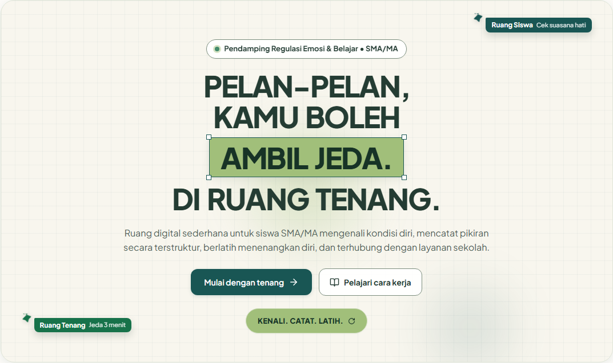
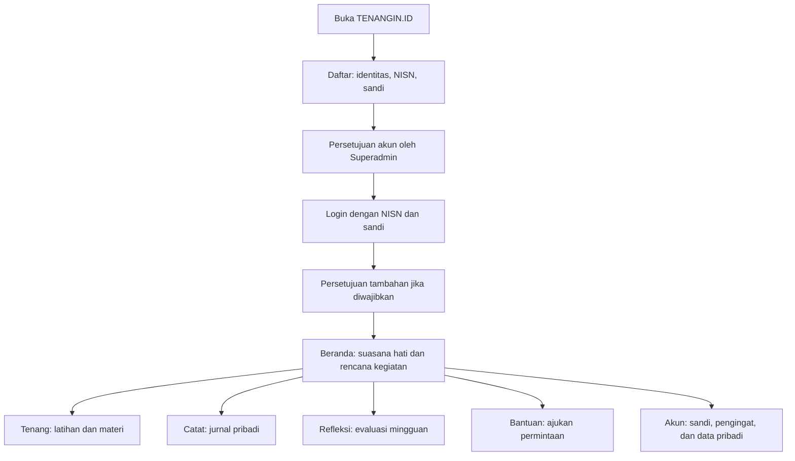
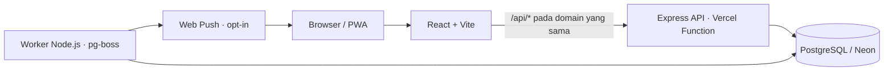

<p align="center">
  
</p>

<h1 align="center">TENANGIN.ID</h1>

<p align="center">
  <strong>Temukan Ketenangan, Kelola Tekanan.</strong><br />
  Ruang digital untuk siswa SMA/MA mengenali suasana hati, mencatat pikiran,
  berlatih menenangkan diri, dan terhubung dengan layanan sekolah.
</p>

<p align="center">
  <a href="https://tenanginid-xi.vercel.app">Live App</a> ·
  <a href="https://tenanginid-xi.vercel.app/masuk">Masuk</a> ·
  <a href="https://tenanginid-xi.vercel.app/api/health">API Health</a> ·
  <a href="https://tenanginid-xi.vercel.app/api/ready">Database Readiness</a> ·
  <a href="./docs/VERCEL_DEPLOY.md">Panduan Deploy</a>
</p>

<p align="center">
  
  
  
  
  
  
  
</p>

---

## Daftar Isi

1. [Ringkasan Proyek](#ringkasan-proyek)
2. [Fitur Unggulan](#fitur-unggulan)
3. [Peran dan Hak Akses](#peran-dan-hak-akses)
4. [Alur Penggunaan Siswa](#alur-penggunaan-siswa)
5. [Arsitektur Sistem](#arsitektur-sistem)
6. [Struktur Repositori](#struktur-repositori)
7. [Instalasi dan Menjalankan Lokal](#instalasi-dan-menjalankan-lokal)
8. [Environment Variables](#environment-variables)
9. [Deployment Vercel](#deployment-vercel)
10. [Keamanan dan Privasi](#keamanan-dan-privasi)
11. [Perintah dan Pengujian](#perintah-dan-pengujian)
12. [Dokumentasi dan Pembaruan](#dokumentasi-dan-pembaruan)
13. [Pengembang dan Lisensi](#pengembang-dan-lisensi)

---

## Ringkasan Proyek

**TENANGIN.ID** adalah aplikasi pendamping regulasi emosi dan pengelolaan stres belajar bagi siswa SMA/MA. Siswa memiliki ruang pribadi untuk mencatat kondisi diri, mengatur kegiatan, menjalankan latihan, dan melakukan refleksi. Guru BK memantau aktivitas sesuai penugasan, sementara Superadmin mengelola akun, konten, bantuan, serta pengaturan layanan.

Identitas visual menggunakan **teal `#195654`**, **hijau daun `#438B6B`**, **sage `#D5DFBF`**, aksen **`#A1BF7A`**, serta latar krem. Antarmuka memakai Plus Jakarta Sans, CSS Modules, komponen responsif, dan aset logo lokal.

Frontend React/Vite dan Express API berjalan pada satu domain Vercel. PostgreSQL menyimpan data serta sesi; deployment saat ini menggunakan Neon. Worker `pg-boss` berjalan terpisah untuk pekerjaan terjadwal.

> Aplikasi bukan layanan diagnosis atau layanan darurat dan tidak dipantau setiap saat. Penggunaan data siswa nyata mengikuti konfigurasi layanan, kebijakan privasi, serta tinjauan pengelola/ahli dalam [keterbatasan dan gerbang pilot](./docs/LIMITATIONS_AND_REVIEW.md).

## Fitur Unggulan

### Ruang Siswa

- **Pendaftaran dan persetujuan akun**: identitas, NISN, serta sandi; akun perlu disetujui Superadmin sebelum dapat masuk.
- **Beranda**: ringkasan aktivitas, pencatatan suasana hati, dan tingkat tekanan belajar opsional.
- **Rencana kegiatan**: tugas, langkah kecil, penanda penting/mendesak, serta jadwal istirahat atau tidur pribadi.
- **Tenang dan pustaka**: latihan berpanduan teks, audio opsional tanpa autoplay, kontrol mulai/jeda/lanjut/berhenti, serta materi yang diterbitkan pengelola.
- **Catat**: jurnal situasi, pikiran, perasaan, dan alternatif realistis. Entri disimpan setelah siswa menekan tombol simpan.
- **Refleksi**: pertanyaan mingguan dan peninjauan aktivitas pribadi.
- **Bantuan**: jam layanan, kontak terverifikasi, dan permintaan bantuan dengan peninjauan sebelum dikirim.
- **Pengaturan akun**: ubah sandi, pengingat opt-in, ekspor data pribadi, dan pengelolaan/penghapusan data sesuai hak akun.

### Pemantauan Guru BK

- Dashboard metadata aktivitas sesuai kelompok penugasan.
- Agregat mingguan dan ekspor JSON/CSV dengan autentikasi ulang.
- Statistik kelompok disembunyikan ketika kontributor berbeda kurang dari **5 siswa**.
- Akses baca untuk pemantauan; isi jurnal, refleksi, nilai mood, dan pesan bantuan pribadi tidak tersedia bagi peran BK.

### Panel Superadmin

| Menu | Fungsi |
| --- | --- |
| **Ringkasan** | Metrik operasional dan aktivitas audit terbaru. |
| **Akun & Role** | Persetujuan pendaftaran, pengelolaan akun/role/status, pemulihan akses, dan penugasan BK. |
| **Data Siswa** | Peninjauan dan pengelolaan data siswa dengan audit akses serta alasan perubahan. |
| **Konten** | Artikel/latihan melalui tahap draf, tinjauan, persetujuan, publikasi, dan arsip. |
| **Bantuan & Pesan** | Tindak lanjut bantuan, status penanganan, respons administratif, dan pesan kelompok. |
| **Pengaturan & Audit** | Identitas layanan, zona waktu, jam layanan, kebijakan akses, tinjauan tata kelola, kapasitas, dan audit. |

Ketersediaan materi, kontak, instrumen, dan layanan mengikuti konfigurasi pengelola. Persetujuan tambahan ditampilkan jika kebijakan ruang kerja mewajibkannya. Lihat [panduan akses siswa](./docs/STUDENT_DASHBOARD.md).

## Peran dan Hak Akses

| Peran | Jalur utama | Akses |
| --- | --- | --- |
| Siswa (`student`) | `/app` | Data pribadi miliknya. Login utama menggunakan NISN dan sandi. |
| Guru BK (`bk`) | `/bk` | Metadata penugasan dan agregat tersupresi, tanpa mengubah data bisnis. Login melalui email staf. |
| Superadmin (`superadmin`) | `/superadmin` | Pengelolaan ruang kerja dan akses data yang diizinkan, dengan audit. Login melalui email pengelola. |

Otorisasi diperiksa pada server. MFA TOTP tersedia untuk staf yang mengaktifkannya; bootstrap Superadmin memakai email/sandi tanpa mewajibkan MFA secara default.

## Alur Penggunaan Siswa



Siswa dapat memilih aktivitas yang dibutuhkan; urutan latihan, jurnal, dan refleksi tidak diwajibkan. Detail tersedia dalam [panduan pendaftaran siswa](./docs/STUDENT_REGISTRATION.md).

## Arsitektur Sistem



| Lapisan | Teknologi |
| --- | --- |
| Frontend | React 18, Vite 6, React Router, TanStack Query, Framer Motion, Lucide, CSS Modules. |
| API | Express 4, JavaScript ESM, Zod, pembatasan permintaan, dan header keamanan. |
| Data | PostgreSQL 15+, Knex migrations, koneksi terpisah runtime/operator/worker. |
| Autentikasi | Sesi PostgreSQL, Argon2id, synchronizer CSRF, dan MFA TOTP opsional. |
| Worker | `pg-boss` untuk agregasi mingguan, retensi harian, penghapusan, dan push berkala. |
| Verifikasi | Vitest, Supertest, React Testing Library, ESLint, dan Playwright. |

**Worker membutuhkan proses Node.js yang terus berjalan.** Frontend/API Vercel saja tidak menjalankan jadwal agregasi, retensi, dan pengingat otomatis. Lihat [runbook operasi](./docs/OPERATIONS_RUNBOOK.md).

## Struktur Repositori

```text
TENANGIN.ID/
├── api/index.mjs                  # Entrypoint Function Vercel
├── backend/
│   ├── database/migrations/       # Migrasi schema PostgreSQL
│   ├── database/fixtures/         # Data khusus pengujian
│   ├── scripts/                   # Bootstrap, migrasi, backup, dan preflight
│   ├── src/config/                # Environment, database, sesi, keamanan
│   ├── src/modules/               # Auth, siswa, konten, BK, Superadmin
│   ├── src/policies/              # Pembatasan akses dan kepemilikan
│   ├── src/jobs/                  # Worker dan handler pekerjaan
│   ├── tests/                     # Unit dan integrasi backend
│   └── .env.production.example    # Template operator/server
├── frontend/
│   ├── public/                    # Ikon, audio, manifest, service worker
│   ├── src/assets/                # Logo dan ilustrasi lokal
│   ├── src/components/            # Komponen UI dan panel akun
│   ├── src/pages/                 # Publik, auth, siswa, BK, Superadmin
│   ├── src/features/              # Auth dan fitur pengelolaan
│   ├── src/styles/                # Token warna, tipografi, gaya global
│   └── tests/e2e/                 # Pengujian browser Playwright
├── docs/                          # Panduan, kontrak API, audit, screenshot
├── stitch_tenangin_prototype_platform/ # Referensi desain awal
├── package.json                   # Perintah npm workspace
├── package-lock.json
├── vercel.json                    # Build, routing API/SPA, header
└── README.md
```

## Instalasi dan Menjalankan Lokal

### Prasyarat

- **Node.js 24.x** sesuai `engines` dan `.nvmrc`, serta npm yang kompatibel.
- **PostgreSQL 15+** dengan database aplikasi dan test terpisah.
- Untuk helper PostgreSQL lokal, set `PG_BIN_DIR` ke folder biner PostgreSQL jika berbeda dari konfigurasi bawaan script.

### 1. Clone dan instal dependency

```bash
git clone https://github.com/tegokkk/TENANGIN.ID.git
cd TENANGIN.ID
npm ci
```

### 2. Siapkan database lokal

```bash
npm run pg:init
npm run db:migrate
```

`pg:init` menyiapkan klaster di `.local/pgdata`, port default `5433`, role operator/runtime, database aplikasi `tenangin_production`, database `tenangin_test`, dan `backend/.env` dengan secret lokal acak. Gunakan helper ini untuk lingkungan lokal terisolasi. Alternatifnya, salin `backend/.env.example` menjadi `backend/.env`, lalu siapkan sendiri koneksi dan hak akses PostgreSQL.

### 3. Buat Superadmin lokal pertama

Tambahkan pada `backend/.env`, lalu isi email valid dan sandi unik minimal 12 karakter:

```dotenv
BOOTSTRAP_ADMIN_EMAIL=
BOOTSTRAP_ADMIN_PASSWORD=
```

```bash
npm run bootstrap:admin --workspace backend
```

Kode/nama sekolah tidak wajib. Bootstrap menyiapkan ruang kerja **TENANGIN.ID** dengan kode internal `TENANGIN-ID`. Akun yang sudah ada tidak ditimpa. Tidak tersedia email atau sandi admin bawaan.

### 4. Jalankan layanan

Jalankan pada terminal terpisah:

```bash
npm run dev:backend
```

```bash
npm run dev:frontend
```

Buka **http://127.0.0.1:5173**; API lokal memakai port **3000**. Untuk pekerjaan latar development, jalankan `npm run dev:worker` dengan koneksi yang sesuai. Worker production memakai role terpisah dan penyiapan schema sesuai panduan deploy.

## Environment Variables

| Variabel | Kegunaan |
| --- | --- |
| `NODE_ENV` | `development`, `test`, atau `production`. |
| `APP_MODE`, `ALLOW_DEMO_SEED` | Runtime memakai `pilot` dan `false`; fixture hanya untuk test. |
| `APP_ORIGIN` | Origin frontend; HTTP lokal untuk development, HTTPS untuk production. |
| `DATABASE_URL` | Koneksi role runtime API dengan hak DML. |
| `DATABASE_ADMIN_URL` | Koneksi operator migrasi/bootstrap; tidak diberikan ke API Vercel. |
| `WORKER_DATABASE_URL` | Koneksi worker pada database aplikasi yang sama. |
| `SESSION_SECRET` | Secret acak minimal 32 karakter untuk sesi. |
| `ENCRYPTION_KEY_ID`, `ENCRYPTION_KEY` | ID kunci dan kunci AES-256-GCM berupa 64 karakter hex. |
| `ENCRYPTION_KEYRING` | Kunci lama untuk dekripsi saat rotasi. |
| `TRUST_PROXY` | Proxy server; adapter Vercel menetapkan `1` otomatis. |
| `DB_POOL_MIN`, `DB_POOL_MAX`, `DB_STATEMENT_TIMEOUT_MS` | Batas pool dan timeout kueri. |
| `VAPID_PUBLIC_KEY`, `VAPID_PRIVATE_KEY`, `VAPID_SUBJECT` | Web Push opsional, sama pada API dan worker. |
| `BOOTSTRAP_ADMIN_EMAIL`, `BOOTSTRAP_ADMIN_PASSWORD` | Superadmin pertama, hanya pada komputer operator. |

Template lengkap: [development](./backend/.env.example), [operator production](./backend/.env.production.example), dan [API Vercel](./backend/.env.vercel.example).

Secret tidak boleh masuk Git atau variabel `VITE_*`, karena variabel frontend dapat masuk ke bundle browser. Pertahankan kunci enkripsi yang sama pada operator, API, dan worker; rotasi memerlukan keyring agar data lama tetap terbaca.

## Deployment Vercel

| Pengaturan | Nilai |
| --- | --- |
| Root Directory | Root repository (`.`) |
| Framework Preset | Other |
| Node.js | 24.x |
| Install Command | `npm ci` |
| Build Command | `npm run build` |
| Output Directory | `frontend/dist` |
| Fluid Compute | Aktif |

1. Siapkan PostgreSQL cloud, misalnya Neon, dan role operator, runtime, serta worker. Gunakan koneksi Direct untuk migrasi dan worker.
2. Isi `backend/.env.production` di komputer operator dengan koneksi dan secret production.
3. Jalankan migrasi, berikan hak akses sesuai panduan, kemudian buat Superadmin:

   ```bash
   npm run db:migrate:production
   npm run bootstrap:production
   ```

4. Import repository di Vercel dan isi ENV **Production** dari template API Vercel. `DATABASE_ADMIN_URL`, `WORKER_DATABASE_URL`, `BOOTSTRAP_*`, dan `TEST_*` tetap pada lingkungan operator/worker.
5. Deploy source terbaru. Perubahan ENV memerlukan deployment baru.
6. Periksa `/api/health`, `/api/ready`, `/masuk`, dan login sesuai peran.
7. Jalankan worker pada host Node.js terpisah dengan `npm run worker:production`.

API memiliki fallback origin HTTPS dari hostname sistem Vercel ketika `APP_ORIGIN` kosong atau masih berupa origin lokal. Custom domain HTTPS tetap didukung. Frontend memakai `/api` pada domain yang sama; `VITE_API_BASE_URL` tidak perlu diisi untuk susunan ini.

**Panduan lengkap:** [docs/VERCEL_DEPLOY.md](./docs/VERCEL_DEPLOY.md), termasuk hak akses database dan pembacaan log startup. Migrasi, bootstrap, dan worker tidak dimasukkan ke Build Command.

## Keamanan dan Privasi

- **Kontrol akses server**: peran, kepemilikan data, dan penugasan BK diperiksa pada API.
- **Sandi dan sesi**: Argon2id, sesi PostgreSQL, cookie `HttpOnly`/`Secure` pada production, dan perlindungan CSRF.
- **Enkripsi data terbatas**: data sensitif yang ditentukan aplikasi memakai AES-256-GCM. Ini bukan enkripsi end-to-end; Superadmin berwenang dapat mengakses data sesuai kebijakan dan audit.
- **Audit akses**: pembacaan dan perubahan administratif dicatat. Hak Superadmin dijelaskan dalam informasi privasi.
- **Privasi kelompok**: agregat kurang dari 5 kontributor berbeda disembunyikan untuk BK.
- **Kendali pengguna**: pengingat opt-in, ekspor dengan autentikasi ulang, serta pengelolaan/penghapusan data pribadi.
- **Pemisahan lingkungan**: production menolak sekolah fixture serta instrumen simulasi; seed test tidak dijalankan pada database layanan.
- **Tinjauan penggunaan nyata**: kontak, jam layanan, kebijakan, materi, dan instrumen perlu dikonfigurasi dan ditinjau pengelola. Jadwal retensi dan push membutuhkan worker aktif.

Lihat [runbook keamanan dan pemulihan](./docs/OPERATIONS_RUNBOOK.md) dan [catatan keterbatasan](./docs/LIMITATIONS_AND_REVIEW.md). Tinjau catatan advisori dependensi pada panduan deploy dan hasil `npm audit` saat menyiapkan rilis.

## Perintah dan Pengujian

Jalankan dari root repository:

| Perintah | Fungsi |
| --- | --- |
| `npm run dev:backend` | API development. |
| `npm run dev:frontend` | Vite development. |
| `npm run dev:worker` | Worker development. |
| `npm run pg:init` / `npm run pg:start` / `npm run pg:stop` / `npm run pg:status` | PostgreSQL lokal. |
| `npm run db:migrate` | Migrasi aplikasi lokal. |
| `npm run db:migrate:production` | Migrasi production dan penyiapan schema worker. |
| `npm run bootstrap:production` | Superadmin pertama pada production. |
| `npm run build` | Build frontend ke `frontend/dist`. |
| `npm run vercel:check` | Pemeriksaan konfigurasi dan hasil build lokal. |
| `npm run vercel:check -- --env` | Tambahan validasi format environment operator. |
| `npm run start:production` | Express production pada host Node.js mandiri. |
| `npm run worker:production` | Worker production terpisah. |
| `npm run lint` | ESLint backend dan frontend. |
| `npm test` | Tes backend dan frontend. |
| `npm run test:e2e` | Alur browser Playwright. |
| `npm run backup:verify --workspace backend` | Verifikasi backup/restore pada lingkungan uji. |
| `npm run capacity:check --workspace backend` | Pemeriksaan kapasitas pool dan rencana kueri. |

Sebelum menjalankan suite pada checkout baru, siapkan PostgreSQL dan migrasikan database test terpisah:

```bash
npm run db:migrate --workspace backend -- --env test
npx playwright install chromium
npm test
npm run test:e2e
npm run lint
npm run build
```

`TEST_DATABASE_URL` dan `TEST_APP_DATABASE_URL` harus menunjuk database test terisolasi. E2E memakai API `3001` dan Vite `5174`, serta mereset fixture. Jalankan tes backend dan E2E bergantian karena memakai database test yang sama. `npm run db:seed:test` hanya diizinkan dengan `NODE_ENV=test` dan verifikasi target database test.

## Dokumentasi dan Pembaruan

| Dokumen | Isi |
| --- | --- |
| [Deployment](./docs/VERCEL_DEPLOY.md) | Vercel, database cloud, ENV, bootstrap, worker. |
| [Production](./docs/PRODUCTION_SETUP.md) | Pengelola dan konfigurasi layanan. |
| [Pendaftaran siswa](./docs/STUDENT_REGISTRATION.md) | NISN dan persetujuan akun. |
| [Dashboard siswa](./docs/STUDENT_DASHBOARD.md) | Mode persetujuan dan akses fitur. |
| [Panduan pengguna](./docs/USER_GUIDES.md) | Referensi peran; ikuti panduan pendaftaran/dashboard untuk alur akses terbaru. |
| [Runbook operasi](./docs/OPERATIONS_RUNBOOK.md) | Worker, backup/restore, rotasi, operasi. |
| [Kontrak OpenAPI](./docs/api/openapi.yaml) | Endpoint API. |
| [Paket review T73](./docs/REVIEW_PACK_T73.md) | Tinjauan ahli dan pengelola. |
| [Keterbatasan](./docs/LIMITATIONS_AND_REVIEW.md) | Gerbang pilot dan batas penggunaan. |
| [Fixture pengujian](./docs/DEMO_ACCOUNTS.md) | Skenario test, bukan kredensial production. |
| [Audit desain awal](./docs/audit/stitch-audit.md) | Keterlacakan referensi Stitch. |

### Pembaruan 21 November 2026

- Logo dan palet teal, hijau daun, sage, serta krem mengikuti referensi klien.
- Landing diperpendek dengan menghapus logo besar dan merapikan label dekoratif pada tablet.
- Penyempurnaan tata letak responsif, dialog, panel Superadmin, dan umpan balik penyimpanan.
- Frontend/API satu domain pada Vercel dengan PostgreSQL cloud.
- Bootstrap Superadmin cukup memakai email dan sandi, tanpa kewajiban kode/nama sekolah.
- Origin HTTPS memakai fallback domain Vercel, dan proxy tepercaya dipatok oleh adapter serverless.
- Diagnostik startup mencatat tahap, kode, dan nama variabel tanpa nilai rahasia.

Acuan produk: [PRD](./PRD.md), [design](./design.md), [structure](./structure.md), dan [TASKLIST](./TASKLIST.md). Dokumen awal tersimpan di `docs/archive/` untuk keterlacakan.

## Pengembang dan Lisensi

- **Pengelola repository:** [tegokkk](https://github.com/tegokkk).
- **Repository:** [tegokkk/TENANGIN.ID](https://github.com/tegokkk/TENANGIN.ID).
- Repository belum menyertakan file lisensi. Hubungi pemilik untuk ketentuan penggunaan atau distribusi; source publik tidak otomatis memberikan lisensi penggunaan.
